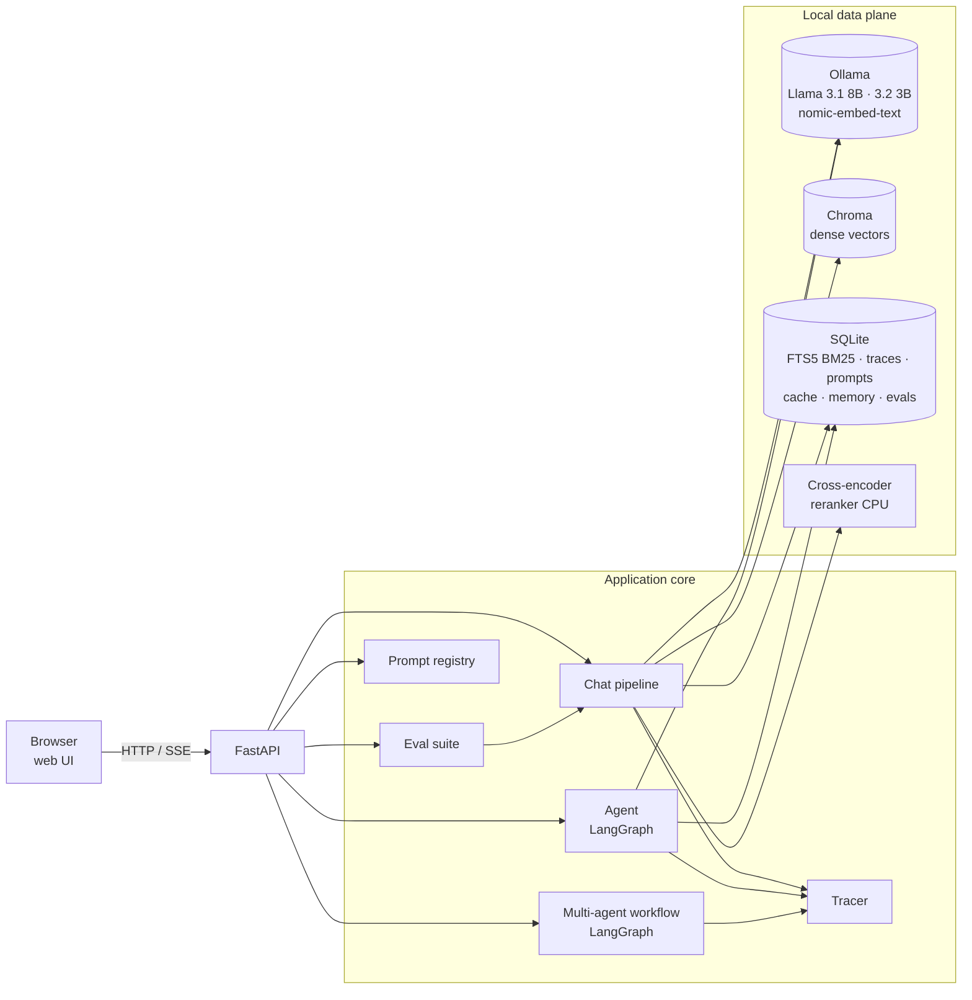
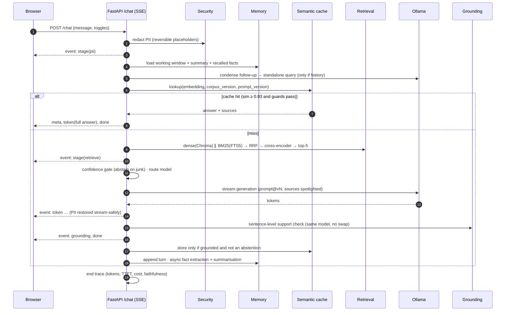
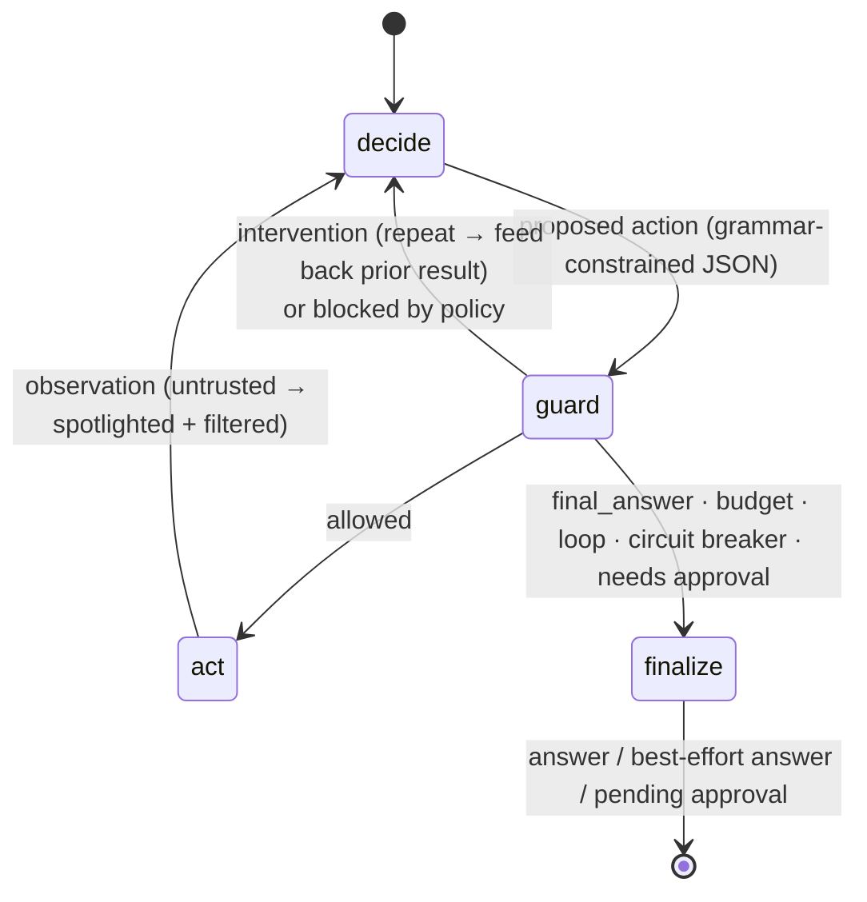
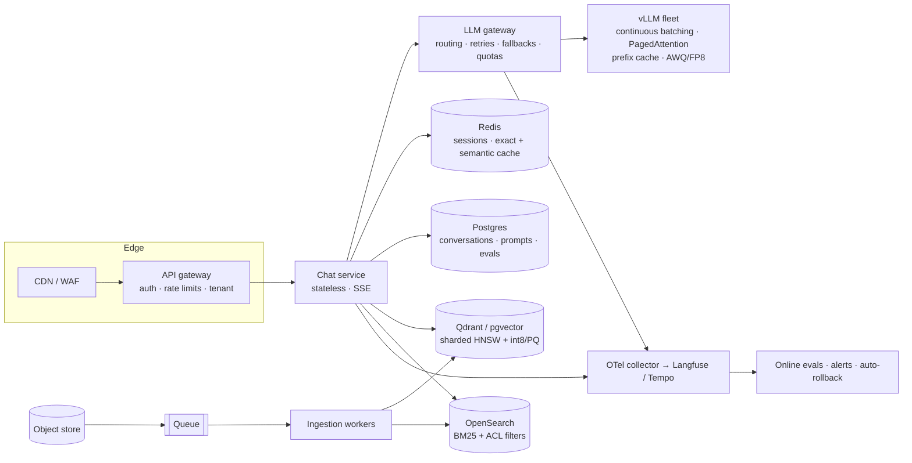

# LocalAI Forge: System Design

A private, fully local RAG and agent platform. It answers questions over a company's own documents with citations, runs tool-using agents, and makes every production concern (caching, routing, grounding, evals, prompt rollback, tracing, PII, injection defense) a visible, measurable feature.

Status: single-node reference implementation on Ollama (Llama 3.1 8B / 3.2 3B), FastAPI, SQLite and Chroma.
Section 9 describes how each piece scales out.

---

## 1. Why this exists

### 1.1 Problem
General chatbots (ChatGPT, Claude) are far stronger at open-ended reasoning than an 8B local model. They are weaker in four places that matter for real business use:

| Need | General chatbot | LocalAI Forge |
|---|---|---|
| Data control | Documents leave the machine | Nothing leaves the machine; works offline |
| Private knowledge | Re-uploaded per conversation, temporary | Persistent, versioned, indexed corpus |
| Trust | Black-box answers | Every sentence cited and checked against sources; full trace per request |
| Engineering control | Prompting only | Chunking, retrieval, routing, prompts, guardrails and evals all owned and measurable |
| Cost at volume | Per-token pricing | Fixed hardware cost; cache and routing reduce compute |

### 1.2 Positioning
The moat is not the model. It is **private data + a specialised retrieval system + engineering control**. The product is not "a smaller ChatGPT". It is a *glass-box knowledge system* that becomes very good at one organisation's documents and workflows, and can prove why each answer is right.

### 1.3 Goals / non-goals
**Goals**
- Grounded answers with citations; abstain when the answer is not in the corpus.
- Every stage observable (timings, inputs and outputs), every change measurable (evals).
- Safe tool use: an agent can't be talked into side effects by documents it reads.
- 100% local: no API keys, no network calls at inference time.

**Non-goals (for this build)**
- Multi-tenant auth/ACLs (designed for in §9, not implemented).
- Horizontal scale (single node; the scale-out path is in §9).
- Beating frontier models on general knowledge.

---

## 2. High-level design

### 2.1 Components

| Component | Responsibility | Module |
|---|---|---|
| Web UI | Chat with a live Inspector, plus lab pages for every concern | `web/` |
| API | REST + Server-Sent Events, static UI hosting | `app/main.py` |
| Chat pipeline | Redact → rewrite → cache → retrieve → rerank → route → stream → verify | `app/pipeline.py` |
| Ingestion | Load, chunk (4 strategies), embed, index into Chroma + FTS5 | `app/rag/` |
| Retrieval | Dense, BM25, hybrid (RRF), cross-encoder rerank | `app/rag/retrieve.py` |
| Semantic cache | Embedding-similarity cache keyed by corpus + prompt version | `app/cache.py` |
| Router | Cheap/smart model selection: rules, cascade, forced | `app/router.py` |
| Grounding | Sentence-level hallucination check | `app/grounding.py` |
| Memory | Working window, rolling summary, long-term facts | `app/memory.py` |
| Agent | Tool-using LangGraph agent with a deterministic guard node | `app/agent.py` |
| Workflow | Planner → researcher → writer → reviewer | `app/workflow.py` |
| Security | Reversible PII redaction, injection scanning, side-effect policy | `app/security.py` |
| Prompt registry | Versioned prompts, active pointer, audit log, eval-gated promotion | `app/prompts.py` |
| Evals | Retrieval metrics, LLM judge, judge calibration, pairwise | `app/evals.py` |
| Tracing | OpenTelemetry-shaped traces and spans in SQLite | `app/tracing.py` |

### 2.2 Technology choices

| Concern | Choice | Why | Rejected alternatives |
|---|---|---|---|
| LLM runtime | **Ollama** | Metal GPU on macOS, model management, streaming, JSON-schema constrained decoding | llama.cpp server (more ops); vLLM (no Metal, overkill for one user) |
| Models | **Llama 3.1 8B** (quality), **Llama 3.2 3B** (fast) | Two tiers make routing real; both fit in 16 GB (one at a time under memory pressure) | 70B (doesn't fit) |
| Embeddings | **nomic-embed-text** with task prefixes | Local, 768-d, strong retrieval quality for its size | OpenAI embeddings (not local) |
| Vector store | **Chroma** (embedded, persistent) | Zero ops, metadata filters, enough for 10⁴–10⁶ vectors | Qdrant/Milvus (servers, built for scale); FAISS (no DB features) |
| Keyword search | **SQLite FTS5** | Persistent, incremental, BM25 built in, same file as app state | rank_bm25 (in-memory, full rebuild per insert); Elasticsearch (heavy) |
| App state | **SQLite** (WAL) | One file, transactional, zero ops | Postgres (the scale-out choice) |
| Reranker | **ms-marco-MiniLM-L-6-v2** cross-encoder | About 170 ms per 20 pairs on CPU; measurable precision gain | bge-reranker-v2-m3 (multilingual, slower), LLM-as-reranker (slow) |
| Orchestration | **Plain Python** for RAG; **LangGraph** for agents | RAG must be explainable line by line; agents need explicit state, loops, a guard node | LangChain chains (hide the mechanics) |
| Structured output | **Ollama `format=` JSON schema + Pydantic + repair loop** | Grammar-constrained decoding, so output always parses | Prompt-only JSON (~95% valid on small models) |
| API | **FastAPI + sse-starlette** | Async, SSE with disconnect detection, OpenAPI | Flask (sync) |
| UI | **Vanilla JS + CSS**, served by FastAPI | No build step, no CDN (stays offline), full design control | Streamlit (generic look, full-page reruns, awkward SSE) |

---

## 3. Low-level design: chat pipeline

### 3.1 Sequence

### 3.2 SSE protocol
| Event | Payload | Purpose |
|---|---|---|
| `stage` | `{stage, ms, status, detail}` | Live Inspector timeline |
| `meta` | `trace_id, route, cache, sources[], pii, standalone_query, prompt_version` | Answer context |
| `ttft` | `{ms}` | Time to first token |
| `token` | `{t}` | Answer text |
| `grounding` | `{faithfulness, citation_coverage, sentences[], unsupported[]}` | Hallucination check |
| `done` / `error` | `{trace_id}` / `{message}` | Terminal |

**Disconnects:** the endpoint checks `request.is_disconnected()` per event and `aclose()`s the generator. That closes the Ollama HTTP stream, so generation stops server-side, and the trace is marked `client_disconnected`. A heartbeat ping every 15 s keeps proxies from closing idle streams.

### 3.3 Ingestion and chunking
Each document is indexed under **all four strategies** at once, so they can be compared live without re-ingesting:

| Strategy | How | When it wins |
|---|---|---|
| `fixed` | 500-char windows | Baseline only; cuts clauses in half |
| `recursive` | paragraph → sentence → word, 800 chars, 120 overlap on word boundaries, **doc-title header** | General default |
| `legal` | one chunk per numbered clause, header `[Doc > Section]` | Contracts: keeps exceptions next to the rule they modify |
| `parent_child` | 300-char children for matching; the parent section is sent to the LLM | Precise match *and* full context |

The **corpus version** is a SHA-1 hash of every chunk's id and content. It changes on any edit and invalidates the cache.

### 3.4 Retrieval
- Dense: Chroma cosine on `search_query:`-prefixed embeddings, top 20.
- BM25: FTS5 `MATCH`, with hyphenated codes (`E-2001`) quoted as phrases, top 20.
- **Reciprocal Rank Fusion:** `score(d) = Σ_r 1 / (60 + rank_r(d))`. Rank-based, so there's no normalisation of incomparable scores.
- Cross-encoder rerank on the fused shortlist; keep 5.
- Confidence gate: skip the LLM only when the top rerank logit is below −10. Measurements showed the logits are **not calibrated relevance** ("stock price", which is out of scope, scored +4.5; "pricing policy", which is in scope, scored −7.6), so out-of-scope abstention is left to the prompt.

### 3.5 Semantic cache
- Key: query embedding, compared **only** against entries with the same `corpus_version` and `prompt_version`.
- Hit: cosine ≥ 0.93 **and** guards pass:
  - negation mismatch ("cancel" vs "don't cancel" ≈ 0.95 cosine),
  - different numbers.
- Write policy: only grounded (faithfulness ≥ 0.8), non-abstaining answers are cached.
- Telemetry: hit rate, latency saved, near-miss similarity histogram for threshold tuning.

### 3.6 Routing
`rules` (zero-latency features: length, reasoning keywords, multi-part, evidence spread, legal top hit), `cascade` (3B drafts → grounding check → escalate to 8B if unsupported), or forced. On 16 GB machines a **single-model mode** (`.env`) avoids weight swapping between models.

### 3.6b Judge (evals)
The LLM judge never produces the score itself:
1. **Rules first.** Out-of-scope references pass only if the answer abstains. A numeric contradiction (no shared numbers, ignoring identifiers from the question) scores 1.
2. **Fact checklist.** The model lists up to 4 key facts in the reference and marks each as present or absent in the candidate, plus whether the candidate contradicts the reference.
3. **Score in code.** A contradiction scores 1; all facts present scores 5; ≥ ⅔ scores 4; and so on. Pass = score ≥ 4.

Calibrated against 20 human labels:

| Judge | Agreement | κ | False pass |
|---|---|---|---|
| Holistic 1–5 rubric (8B) | 0.75 | 0.52 | 0 |
| **Fact checklist + rules (8B)** | **0.90** | **0.80** | **0** |

### 3.7 Grounding (hallucination detection)
1. Split the answer into factual sentences (drop preambles such as "Based on the sources…").
2. One structured call with a schema of **exactly N verdicts** (`minItems = maxItems = N`), each `{index, evidence_quote ≤ 200 chars, supported, source}`. Quoting before the verdict acts as cheap chain-of-thought.
3. `faithfulness = supported / N`, plus a free citation-validity check.
4. It runs on the model that answered, so there's no model swap.

### 3.8 Memory
| Tier | Storage | Policy |
|---|---|---|
| Working | `messages` table | last 6 turns verbatim |
| Episodic | `session_summaries` | rolling summary of older turns (3B, async) |
| Long-term | `memory_facts` + Chroma `memory` | facts extracted from **user** turns; dedupe at 0.97, **supersede** at 0.88 (audit trail, not delete); scoped per user |

---

## 4. Low-level design: agent

- **Tools:** `search_kb`, `lookup_customer`, `lookup_ticket`, `calculator` (AST-safe), `remember`, `recall`, `send_email` (side effect).
- **Loop control:** signature = (tool, *sorted token set* of args), so rephrasings count as repeats. The first repeat gets an intervention; the second stops the run. A **per-tool circuit breaker** trips after 2 failures. There's also no-progress detection and a hard step budget. Any forced stop still produces a best-effort answer.
- **Injection defense:**
  1. Scan raw tool output.
  2. Strip injected sentences.
  3. Wrap in `<untrusted>` tags.
  4. **Deterministic policy:** email recipients must be internal or typed by the user.
  5. **Human approval** for side effects.
- `simulate_compromised` forces the model to obey the injection, to prove that (4) and (5) hold regardless of the model.

**Multi-agent workflow:** planner (8B, structured sub-questions) → researcher (RAG per sub-question) → writer (8B) → reviewer (grounding check; sends back with critique, max 2 rounds). Every node and inner call is a span under one trace.

---

## 5. Data model (SQLite)

| Table | Key columns |
|---|---|
| `chunks` / `chunks_fts` / `parents` | id, doc, strategy, section, parent_id, content |
| `traces` | id, kind, status, prompt_version, model, ttft_ms, total_ms, tokens_in/out, meta(json) |
| `spans` | id, trace_id, parent_id, name, started, ended, ms, input, output, error |
| `prompts` / `prompt_active` / `prompt_events` | name, version, template, note · active pointer · audit log |
| `cache` / `cache_events` | query, embedding, answer, sources, corpus_version, prompt_version · hit/similarity/saved_ms |
| `messages` / `session_summaries` / `memory_facts` | session/user scoped memory, superseded_by |
| `eval_runs` | config, metrics, per-question rows |

Chroma collections: `chunks` (metadata: doc, strategy, section, parent_id) and `memory` (metadata: user_id, kind).

---

## 6. API surface

| Method | Path | Purpose |
|---|---|---|
| POST | `/chat` | RAG chat, SSE stream |
| POST | `/chat/sync` | Same, as JSON (used by evals) |
| POST | `/retrieve` · `/debug` | Retrieval with all stages · stage-by-stage diagnosis |
| POST | `/agent` · `/agent/approve` · GET `/agent/outbox` | Agent run · human approval · side-effect log |
| POST | `/workflow` | Multi-agent workflow |
| GET | `/traces` · `/traces/{id}` | Trace list · trace with spans |
| GET | `/metrics` · `/cache` · POST `/cache/probe` | Latency, cost, cache stats |
| GET/POST | `/prompts` · `/prompts/{n}/activate/{v}` · `/rollback` · `/gate/{v}` | Prompt registry |
| POST | `/eval/retrieval` · `/eval/generation` · `/eval/judge-calibration` · `/eval/pairwise` | Evals |
| POST | `/ingest` · `/ingest/corpus` · GET `/corpus` · `/chunks` | Knowledge base |
| POST | `/security/redact` · `/security/scan` | Security playgrounds |
| POST | `/lab/ttft` · `/lab/concurrency` | Latency experiments |

---

## 7. Frontend design
- **Concept:** a glass-box assistant. The chat sits in the centre; a live **Inspector** shows each pipeline stage as it completes (with timings), the sources with dense/BM25 ranks and rerank scores, and a per-sentence grounding verdict. Citation chips `[n]` jump to the source.
- **Pages:** Chat · Agent Lab · Traces & Workflows (waterfall) · Retrieval Lab · Debug · Knowledge base · Metrics & Cost · Evals & Judge · Prompts · Security · Latency Lab · Playbook.
- **Engineering:** vanilla JS (~1k lines), no build, no CDN. A custom Markdown renderer escapes all model output before formatting. Light and dark themes come from CSS tokens. Fixed-order categorical palette for charts.

---

## 8. Measured results (Apple M5, 16 GB)

| Metric | Value |
|---|---|
| Warm TTFT (3B / 8B, free RAM) | ~1.5 s / ~2.5–4 s |
| Semantic-cache hit, end to end | 0.3–0.8 s |
| Rerank 20 candidates (CPU) | ~170 ms |
| BM25 (FTS5) | < 5 ms |

**Retrieval hit@1 on 43 labelled questions:**

| Config | hit@1 |
|---|---|
| Dense | 0.884 |
| BM25 | 0.907 |
| Hybrid | 0.907 |
| Hybrid + rerank | 0.930 |
| Legal chunking + hybrid + rerank | **0.977** |

### End-to-end eval: 47 golden questions, production config (prompt v3)

| Metric | Value |
|---|---|
| Pass rate (judge score ≥ 4) | **80.9%** |
| Faithfulness (sentence-level) | 0.973 |
| Hallucination rate (answers with any unsupported sentence) | 4.3% |
| Abstention accuracy | 0.894 |
| Citation coverage | 0.95 |
| TTFT p50 / total p50 | 3.4 s / 11.7 s |

By category: out-of-scope 4/4 · policy 8/9 · technical 8/9 · pricing 7/8 · contract 9/11 · security 2/4 · multi-doc 0/2.

**Error analysis of the 9 failures** (each read by hand):
- **Over-abstention (5): the main real failure.** The right chunk *was* in the prompt every time, but the answer had to be inferred ("SCIM is Enterprise only" → "not on Business"; "below 99.0% → 25%" for 98%). The 8B model treated "not stated verbatim" as "not in the sources".
- **Per-plan value mix-up (1):** gave Pro's 90 days instead of Business's 1 year. The grounding check missed it because "90 days" *is* in the source.
- **Eval errors (3), fixed in the harness:** the numeric rule read section numbers (9.2/9.3) as values; two golden references were badly worded.

**Prompt v4 (candidate)** adds "answer what the sources imply" and "use the value for the plan asked about". On the 10 previously failing questions, pass rate went 0.2 → 0.6 and abstention accuracy 0.5 → 0.9. Its first faithfulness drop (0.9 → 0.7) was a **grounding false positive**: the checker never saw the question, so "No, SCIM is Enterprise only [1]" looked unsupported. Fixed with grounding v2, which includes the question.

**Status:** v4 is registered but **not promoted**. The full 47-question gate (v3 vs v4) needs ~1 hour of local inference and was stopped when the 16 GB machine hit ~34 GB of swap. Until v4 passes the gate, production stays on v3, which is exactly what the gate is for.

### Failures found while building, and their fixes
| Symptom | Root cause | Fix |
|---|---|---|
| All requests hang | JSON-grammar call with no output cap generated 5,700 tokens; Ollama serves 1 request at a time | `num_predict` cap on every call; bounded arrays |
| Grounding check 80 s, then invalid JSON | Unbounded verdict list; the model invented extra items | Schema with exactly N items |
| Segfault | Two threads ran torch inference on MPS | Reranker pinned to CPU behind a lock |
| Agent quotes the wrong customer | `"" in "hooli"` is `True` in the lookup tool | Skip empty fields |
| Loop guard never fires | Model rephrases the failing call | Normalised signatures + circuit breaker |
| False injection alarm | Scanner ran on text already wrapped in `<untrusted>` | Scan raw text, then wrap |
| Stale cache after edits | Corpus version hashed ids, not content | Hash content |
| 60 s answers | 16 GB machine swapping between 8B and 3B weights | Single-model mode; grounding on the answering model |
| Contract terms presented as general policy | Prompt didn't scope customer-specific docs | Prompt v3 attribution rule, shipped via the registry |
| Eval gate **promoted** a bad prompt | Sampled the first 6 golden rows (all easy pricing); holistic judge favoured verbose answers; citations not gated | Stratified sampling, citation coverage gated, fact-checklist judge. The gate now blocks v2 (citations 0.9 → 0.0) |
| LLM judge disagreed with humans (κ 0.52) | 8B model asked for a holistic 1–5 score penalised terse correct answers | Model only marks key facts present/contradicted; score computed in code; numeric and out-of-scope checks by rule → κ 0.80, 0 false passes |
| Grounding check flagged correct "No, …" answers | The checker never saw the question, so a yes/no answer looked like an unsupported claim | Grounding prompt v2 includes the question |
| Over-abstention on inferable answers (5/47) | Prompt said "abstain if sources don't contain it"; the 8B model read that literally | Prompt v4 (answer implied facts): 0.2 → 0.6 pass on the failing subset; awaiting a full gate |
| `mlx-lm` vanished after install | `uv run` syncs the project env exactly and removed it | Run training tools via `uvx` in an isolated env |
| UI kept talking to stale code after restart | Graceful shutdown hung on an in-flight request; new server couldn't bind the port | `run.sh` waits for the port to free, then force-kills |

---

## 9. Scaling to production

| Concern | Single node (now) | Production |
|---|---|---|
| Inference | Ollama, 1 request at a time | vLLM / SGLang on GPUs, autoscale on queue depth and KV-cache use |
| Vectors | Chroma | Sharded Qdrant/pgvector, quantised HNSW, tenant/ACL filters *before* top-k |
| BM25 | SQLite FTS5 | OpenSearch |
| State | SQLite | Postgres + Redis |
| Ingestion | synchronous | object store → queue → stateless workers, content-hash idempotency |
| Tracing | SQLite spans | OpenTelemetry → collector → Langfuse/Tempo, 100% of errors + sampled successes |
| Prompts | registry + gate | + canary by user hash, auto-rollback on online metrics |
| Security | regex PII, policy gate | + NER PII, per-tenant tool permissions, egress allowlists |

**Back of the envelope (1M DAU):** 10M messages/day ≈ 115 msg/s average, ~500 msg/s at peak, × ~500 output tokens ≈ 250k tokens/s at peak. That's a few hundred GPUs with continuous batching, before caching and routing (each of which can remove a large fraction of LLM calls).

---

## 10. Problem → implementation map

| # | Problem | Where |
|---|---|---|
| 1 | RAG for 10M docs | §9, Knowledge base page |
| 2 | Debug wrong answers | `app/debug.py`, Debug page |
| 3 | Chunking for contracts | `app/rag/chunking.py`, Knowledge base page |
| 4 | BM25 vs dense vs hybrid | `app/rag/retrieve.py`, Retrieval Lab |
| 5 | Reranker and measurement | Retrieval benchmark, Evals |
| 6 | Cut cost 70% | cache + router + rerank, Metrics page |
| 7 | First-token latency | keep_alive, warmup, Latency Lab |
| 8 | Semantic cache | `app/cache.py`, Metrics page |
| 9 | Cheap/smart routing | `app/router.py`, Chat toggles |
| 10 | Reliable tool use | `app/agent.py`, Agent Lab |
| 11 | Agent loops | guard node, Agent Lab "broken tool" |
| 12 | Long-running memory | `app/memory.py`, Agent "remember/recall" |
| 13 | Always-valid JSON | `llm.structured()` |
| 14 | Hallucinations | `app/grounding.py`, Inspector |
| 15 | Eval suite | `app/evals.py`, `data/eval/` |
| 16 | Trustworthy LLM judge | judge calibration, pairwise |
| 17 | Prompt injection | `app/security.py` + policy gate |
| 18 | PII redaction | `Redactor`, Security page |
| 19 | Fine-tune vs RAG vs prompting | Playbook |
| 20 | LoRA on 5K examples | `scripts/lora/` |
| 21 | Serving at scale | §9, Latency Lab |
| 22 | SSE and disconnects | `/chat`, Stop button |
| 23 | Multi-agent tracing | `app/workflow.py`, Traces page |
| 24 | Prompt rollback | `app/prompts.py`, Prompts page |
| 25 | ChatGPT for 1M users | §9 |
